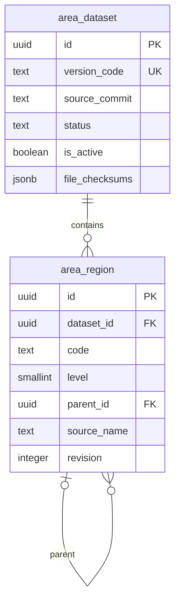

# Database integration

`area-kit` uses one PostgreSQL library with two tables. The host runs the migration explicitly and owns connection pooling, migration bookkeeping, backups, privileges, and any application address table.

```ts
import { areaMigrationSql, createAreaTables } from "area-kit/postgres";

export const sqlForHostMigration = areaMigrationSql("public");
export const tablesForHostQueries = createAreaTables("public");
```

## Schema and relationships

`area_dataset` is one immutable source identity plus mutable lifecycle/import metadata. `id` is the dataset identity; `version_code` is unique and stable for the pinned source rules. It stores source URL and commit, rules/code scheme, `data_as_of`, source publication date, five-file checksums, coverage, level counts, status, one-active flag, progress/report JSON, and timestamps. `status` is `importing`, `ready`, or `failed`; only ready data can be active, and `imported_at` is present exactly for ready data. A partial unique index permits only one active dataset.

`area_region` belongs to one dataset and keeps the original `code`, `source_name`, `level`, same-dataset parent, classified `node_kind`, host-facing display override, `sort`, `enabled`, optimistic `revision`, and timestamps. `(dataset_id, code)` is unique. Levels are 1 through 5; roots have no parent and every lower level has one. The `(dataset_id, parent_id)` foreign key prevents cross-snapshot ancestry. `parent_sort_code` supports child pages and `level_sort_code` supports level pages.



## Source-to-schema mapping

The importer retains the source code and name exactly and derives the `parent_id` from the source ancestor columns. It does not infer parentage from code prefixes or names.

| Source CSV | Level | Source columns used for ancestry | Persisted mapping |
| --- | ---: | --- | --- |
| `provinces.csv` | 1 | `code`, `name` | root `area_region` |
| `cities.csv` | 2 | `provinceCode`, `code`, `name` | parent province |
| `areas.csv` | 3 | `provinceCode`, `cityCode`, `code`, `name` | parent city |
| `streets.csv` | 4 | `provinceCode`, `cityCode`, `areaCode`, `code`, `name` | parent county/district |
| `villages.csv` | 5 | `provinceCode`, `cityCode`, `areaCode`, `streetCode`, `code`, `name` | parent township/street |

The only navigation-group classification is fixed, source-and-commit-specific evidence for nine level-2 tuples (`1101`, `1201`, `3101`, `5001`, `5002`, `4190`, `4290`, `4690`, `6590`). Other special-looking names remain `unknown`; a name alone never establishes administrative meaning. `versionCode` is the stable source identity `modood-administrative-divisions-of-china:c49d495b40ac73eb1a66f6eeae5f8fd10696f035:v1`, not a statement that the data is current.

Store address snapshots in host-owned records as `datasetId`, `versionCode`, validated endpoint `code`, and the returned `pathCodes`/`pathNames`. These snapshots preserve historical presentation even when a later dataset becomes active. Do not overwrite old addresses during activation; resolve them against their saved dataset when it remains available.

## Transaction and cache responsibilities

Import writes a full dataset, re-audits it, and marks it ready only after verification; activation chooses the one ready active dataset. `updatePresentation` checks the caller's `admin.write` authorization and exact revision inside a write transaction. The host must invalidate cache entries for every process after a successful presentation change. The package owns neither external caches nor host address writes.
